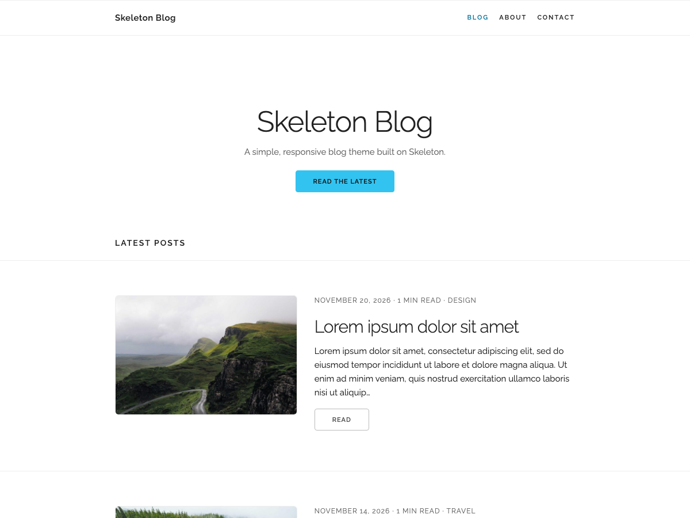

# Skeleton Blog

A free, open source WordPress blog theme by [Mehran Shahmiri](https://github.com/mehranshahmiri), built on [Skeleton](http://getskeleton.com/), the responsive CSS boilerplate by Dave Gamache. The design follows the look of the getskeleton.com site: a narrow centered column, a thin sticky navigation bar, a calm hero and clean post lists.

## Features
- Light, fast and readable. No JavaScript of its own, and no requests to other sites (the Raleway font is bundled).
- Home hero with title, tagline, button and optional header image, all editable in the Customizer, with live preview.
- Layout: single column, or content with a right sidebar.
- Colour scheme: light, dark, or follow the visitor's device. Accent colour picker and custom background. Link and button colours keep AA contrast automatically.
- Templates: home, front page, single, page, archive, author, search, attachment and 404. Page templates: Full width and Landing page.
- Threaded comments, post navigation, author box, reading time, sticky posts, post format styles.
- Primary, footer and social menus, a footer widget area and a sidebar, custom logo.
- Block editor support: `theme.json` (palette, font sizes, widths), editor styles and four block patterns.
- Starter content, translation ready (`languages/skeleton-blog.pot`), accessibility ready (skip link, focus styles, ARIA labels).
- Passes the WordPress coding standards (WPCS) and is compatible with PHP 7.4 and later.

## Install
1. Download or build `skeleton-blog.zip` (run `dev/build-zip.sh`, or zip the `skeleton-blog/` folder).
2. In WordPress: Appearance > Themes > Add New > Upload Theme.
3. Activate it, then set up a menu under Appearance > Menus and look at Appearance > Customize > Skeleton Blog.

Requires WordPress 6.0+ and PHP 7.4+.

## Repository layout
- `skeleton-blog/` is the theme folder that goes into `wp-content/themes/`.
- `dev/build-zip.sh` builds `dist/skeleton-blog-<version>.zip` from it.

## Credits
- [Skeleton](http://getskeleton.com/), (c) 2014 Dave Gamache, MIT License. This theme is built on it and its look is inspired by the getskeleton.com design. License text: `skeleton-blog/css/skeleton-license.txt`.
- normalize.css, Nicolas Gallagher and Jonathan Neal, MIT License.
- Raleway font, The Raleway Project Authors, SIL Open Font License 1.1.
- Demo photos are not included.

## License
GNU General Public License v2 or later. See `LICENSE`.
